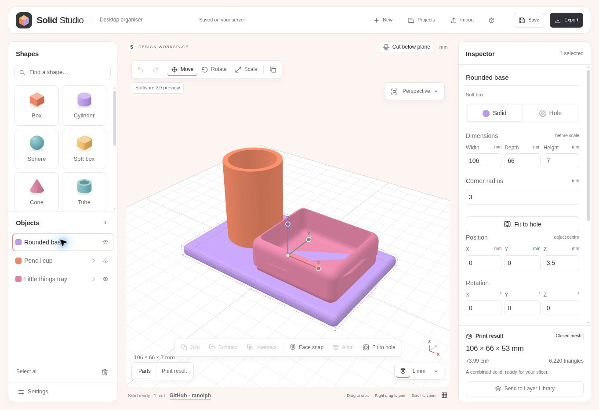
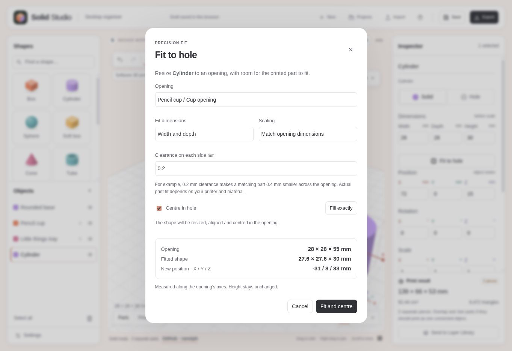
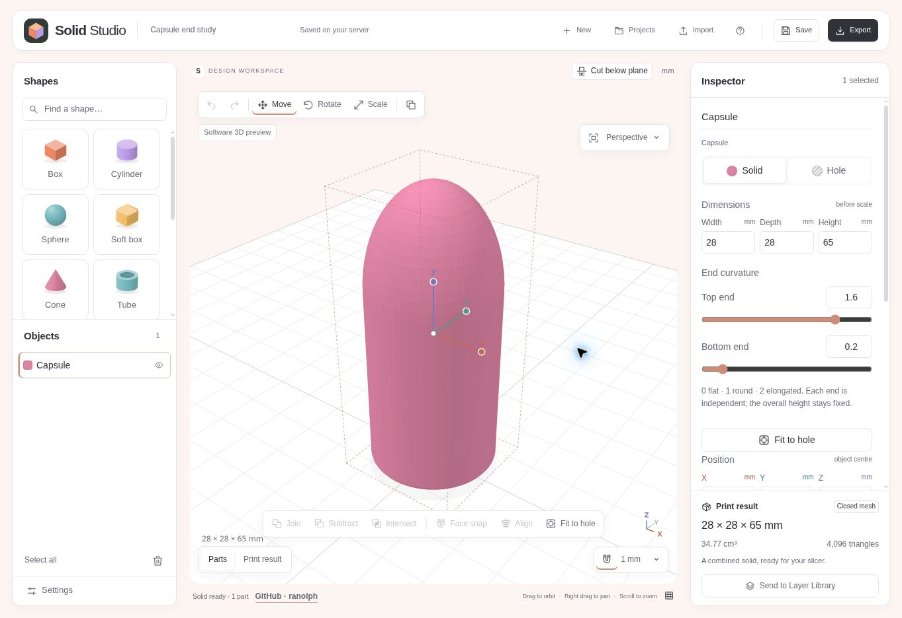
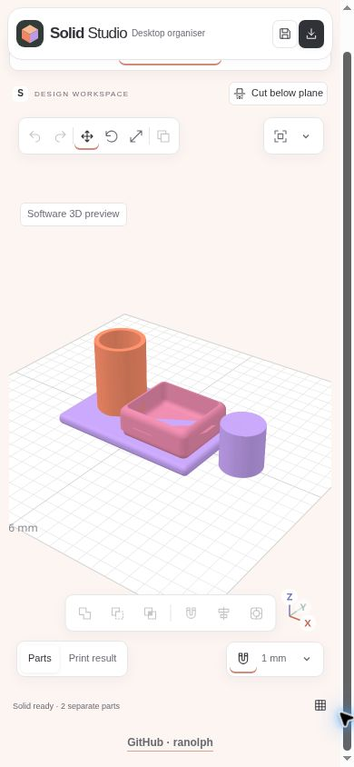

# Solid Studio

**Version 1.2.0 · White interface update 2026-11-20 v3 · MIT-licensed · Self-hosted**

A self-hosted browser workspace for building 3D-printable objects from editable shapes. Solid Studio runs on your server; the 3D view and solid geometry calculations run in the browser. The packaged app includes its JavaScript and WebAssembly dependencies, so normal modelling needs no CDN, cloud account, AI service or GPU in the server.

## Screenshots

These screenshots show the white interface update using built-in starting designs and demonstration shapes. White panels, cards, controls and dialogs sit against a very pale coral backdrop. Neutral graphite text, a white build plane and neutral lighting keep the workspace clear, with small coral selection and focus accents drawn from the Solid Studio icon. On mobile, the GitHub credit sits at the end of the page, below the full workspace and its controls.

### Shape, combine and edit



Build printable objects from simple shapes, combine solids and cuts, and return to their source parts whenever you need to make a change.

### Fit a part to an opening



Resize an insert to an opening, choose printing clearance and centre it automatically. **Fill exactly** is available for matching profiles that need zero clearance.

### Adjust each capsule end



Adjust each capsule end independently while keeping the overall dimensions fixed.

### Mobile workspace



Switch between Shapes, 3D view and Inspector. The author link stays at the bottom of the page.

## Modelling

The shape palette has **12 primitives**: boxes, rounded boxes, cylinders, cones, spheres, tubes, rings, wedges, pyramids, polygon prisms, capsules and decorative gear blanks. Gear blanks are not mechanically specified involute gears.

| Task | Controls |
| --- | --- |
| Inspect a part | Orbit, pan and zoom the 3D view; use the camera presets or **F** to fit |
| Set exact sizes | Select an object and enter width/depth/height in millimetres |
| Move / rotate / scale | Coloured 3D handles or numeric inputs; shortcuts **W / E / R** |
| Attach objects | **Face snap**, then click a face on the selected object and a target face; uses a 0.1 mm overlap |
| Join solids | Shift-select objects, then **Join**; original source parts remain editable |
| Cut / intersect | **Subtract** uses the first-selected object as the base; **Intersect** keeps shared material |
| Make a negative volume | Change a root object's role to **Hole**, then use **Print result** to inspect the cut |
| Fit an insert to a hole | **Fit to hole** resizes and centres a selected shape in a cutting shape or tube opening; **Fill exactly** matches all three dimensions with zero clearance |
| Cut at the build plane | **Cut below plane** removes material below world Z = 0 and closes the new flat face; undo restores it |
| Shape capsule ends | Set **Top end** and **Bottom end** curvature independently: 0 flat, 1 round, 2 elongated |
| Arrange repeated details | **Align**, **Repeat** in a line or circle, **Mirror**, **Duplicate**, and **Drop to bed** |
| Edit a combined object | Select its group and choose **Edit source parts**; return to the whole design afterward |
| Keep or transfer work | **Save** on the server, download `.solid.json`, import JSON/STL, export STL or send to Layer Library |

The initial browser workspace opens an editable desktop organiser. **New** offers a blank workplane, mounting bracket, project enclosure and phone stand as additional starting points. These are procedural source shapes; nothing is inserted into your saved-project collection until you save it.

**Fit to hole** uses a negative object, a saved subtraction cutter or a tube's bore as its target. **Centre in hole** is enabled by default: the shape aligns with the opening's axes and centre. Turn it off to resize the part while keeping it at its current position for separate printing. Clearance is per side: a 10 mm round opening with the default 0.2 mm clearance gives a matching 9.6 mm peg. Fit width/depth only to keep the original height, or all three axes to fit a cavity. Choose independent dimension matching or keep proportions across the selected axes.

Use **Fill exactly** to select all three dimensions, match the opening's dimensions, set zero clearance and enable centring in one step. Matching profiles then fill the cavity; it does not turn a different source profile into the same shape. Box-like inserts fitted to round openings account for their corners. More complex profiles are sized from their bounds and need inspection, and holes inside arbitrary imported STL meshes are not automatically inferred.

A loose root **Hole** normally subtracts material from every visible solid. When centring a separate part in that hole, Solid Studio attaches the hole to the existing body solids in an editable cut group, leaving the fitted part outside that subtraction. If there is no other body, the loose hole is retained as a hidden reference. This prevents the newly centred part from disappearing. Undo restores the previous object structure and fit. While editing a Difference or Intersection group's source parts, return to the whole design to centre a separate insert; resizing in place remains available. An insert placed against other solids with zero clearance can become part of the same exported solid. Keep it separate or use selected-object export when it needs to print separately.

Capsule end roundness controls the depth of the top and bottom curved caps independently while retaining the requested total dimensions. If the two caps would exceed the capsule height, their depths are reduced proportionally. Build-plane cuts retain editable source shapes and create a closed face; later transforms carry the cut with the object.

Keep your project JSON to retain editable primitives and operation history. STL is the printable mesh export, with dimensions intended as millimetres. STL does not encode a unit declaration, colours or the original editing history. Export can use the whole design or selected objects, with Standard or Fine surface detail.

Use your slicer to select a printer, material, supports and toolpaths. Preview colours do not become colours in an STL. Disconnected components can be exported together, but they become one physically connected print only when their solids actually meet. The geometry engine rejects meshes that cannot represent a valid closed solid; it is not a general scan-repair tool or a constrained engineering CAD sketcher.

## TrueNAS installation

Use the generated **install_solid_studio.py** standalone installer from the release package. Place it in a share you can reach from the TrueNAS shell, then run:

```sh
/usr/bin/python3 -I -B -u /path/to/install_solid_studio.py --install
```

The installer creates or updates the **separate TrueNAS App named `solid-studio`**. It builds its bundled application image and registers or updates it through `midclt`; it does not use a manually started Compose stack on TrueNAS. No other app is stopped or changed. A new installation selects an unused port starting at **8788**; an update keeps the existing port. It prints the final address. Use your NAS address in place of `<your-NAS-address>`.

Defaults:

| Setting | Default |
| --- | --- |
| Install directory | `/mnt/Apps_deploy/solid_studio` |
| Persistent projects/settings | `/mnt/Apps_deploy/solid_studio/data` |
| App UID/GID | `568:568` |
| Container web port | `8080` |
| Host port | First available from `8788` |
| Container memory limit | `512 MiB` |

Run without `--install`, or with `--dry-run`, to verify the bundle and inspect the plan without writing files. To choose a different dataset or port:

```sh
/usr/bin/python3 -I -B -u /path/to/install_solid_studio.py --install --root /mnt/YourPool/apps/solid_studio --port 8790
```

For a new installation, use a dedicated directory whose parent dataset already exists. The installer sets ownership only on its own newly created data directory and checks access as the runtime UID. If your dataset ACL blocks it, adjust that directory's access in TrueNAS, then retry. `--prepare-only` extracts the release and resolved configuration without building/registering an app. The resolved configuration refers to a local image that `--install` still needs to build.

A same-release healthy re-run reports the installed app. **To update v1.0.0 or v1.1.0, run the v1.2.0 installer with the same `--install` command and installation root.** It verifies the recorded app identity, data mount and port, then builds a separate versioned image while the current app stays available. It briefly stops only Solid Studio, saves a checked SQLite backup and the previous app definition under `backups/`, and applies the new image through `app.update`. Saved projects, the Layer Library address, port and existing service options are retained. The old image/release remains available.

If activation or health verification fails, the installer restores the previous app definition and checks the previous release. It retains the live database instead of replacing it with an older copy. If a TrueNAS job is unresolved, it records that state and does not race the pending job with another update or rollback. Inspect **Apps → solid-studio → Logs**, **Jobs**, and `install-state.json` / `update-state.json` before further action. Unrelated apps and unmarked directories are never overwritten. An app that was stopped before an update is verified and left stopped afterward.

The first image build needs internet access to obtain `python:3.12-slim`. There are no host `pip` or `npm` installations. The app requires a Docker-based TrueNAS Apps release with `midclt` and `docker` available; it is not an installer for legacy Kubernetes-based TrueNAS releases.

## Other Linux servers, PCs and Macs

With Docker Engine/Desktop and Docker Compose available, extract the source ZIP and run:

```sh
docker compose up -d --build
```

Open `http://<host-address>:8788`. The Compose file uses a named volume for projects and settings. Copy `.env.example` to `.env` if you need a different port or UID/GID. The Python base image supports common AMD64 and ARM64 hosts; native execution on every hardware combination has not been tested. The client needs a current browser with WebAssembly. WebGL2 provides the full 3D renderer; a software canvas view is available when WebGL cannot start. Software rendering is slower for complex meshes. Editing capacity is limited by the device running the browser, even when the server is powerful.

For a direct Python deployment, Python **3.10 or newer** is enough:

```sh
python3 server.py --host 0.0.0.0 --port 8788 --data ./data
```

The packaged browser dependencies are already bundled. Running the app requires neither Node.js nor Python third-party packages. Node.js is needed only for JavaScript tests, the optional development command and dependency maintenance.

This app is designed for a trusted LAN or VPN and has no user accounts. Keep it behind your existing private-network access rather than exposing its unauthenticated project APIs directly to the public internet.

## Saving and moving projects

Server saves live in `solid-studio.sqlite3`, including project history inputs and settings, under the configured data directory. Export project JSON to move an editable design between servers. An STL import restores a mesh, not the original primitive history. Browser draft storage is useful recovery but is not a substitute for saving/downloaded copies.

Back up the data directory with the Solid Studio app stopped, or use a SQLite-aware backup while it is running; SQLite's WAL files must not be omitted from a live file copy. Restart only this app after a stopped backup. Docker named volumes survive ordinary container replacement; deleting the volume deletes saved projects.

The server defaults to an empty project list. Built-in starting designs, if opened in the editor, are procedural examples rather than imported personal models.

## Optional Layer Library connection

1. Open **Studio settings** and enter your Layer Library's direct private-LAN or Tailscale address. The default is blank, so other people can configure their own library.
2. Use **Test connection**, then save the setting. A container's `localhost` is its own container; use the reachable host/LAN address for a different app.
3. Choose **Send to Layer Library**, or open **Export STL** and select **Layer Library** as the destination. Choose the whole design or selected objects, then send the STL.

The connection can also be configured from the export dialog. The app builds the same closed solid mesh used for a normal STL download before it sends anything. No example models or saved personal models are uploaded automatically.

Transfers use Layer Library's existing upload session and place new models in the **Solid Studio** collection. Existing duplicate models retain their title, notes and collection. Transfer receipts prevent resending a confirmed request ID; an interrupted/uncertain transfer tells you to inspect the library before starting another. Small editable projects are also attached as notes when a newly created model can be positively identified. Download/save the project JSON separately when the project is large or metadata cannot be attached.

The integration supports the open-access, `trusted_lan` Layer Library API. URLs are restricted to private/LAN/Tailscale destinations, redirects are rejected, and DNS addresses are checked and pinned when connecting.

## Server configuration

| Variable | Meaning | Default |
| --- | --- | --- |
| `HOST` | HTTP listen address | `0.0.0.0` |
| `PORT` | HTTP port inside the process/container | `8080` |
| `DATA_DIR` | Writable project database directory | `./data` beside server |
| `LAYER_LIBRARY_URL` | Initial optional connection; saved setting takes precedence | Empty |

Project JSON is limited to 20 MiB, 256 total objects and 24 nested operations. Imported meshes are limited to 250,000 total input triangles per project; evaluated output is capped at 750,000 triangles. STL files and Layer transfers are limited to 40 MiB. Geometry/browser limits may be lower to keep editing responsive; oversized/invalid input is rejected with an error, never silently substituted with a different model.

API details are in [docs/API.md](docs/API.md). Dependencies and their licences are recorded in `THIRD_PARTY_NOTICES.md` and the bundled vendor licence files.

[GitHub · ranolph](https://github.com/ranolph)

